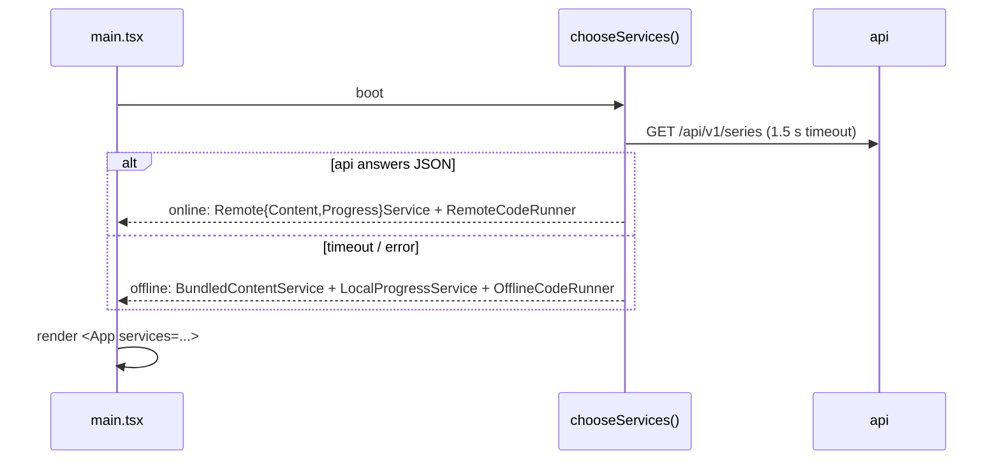
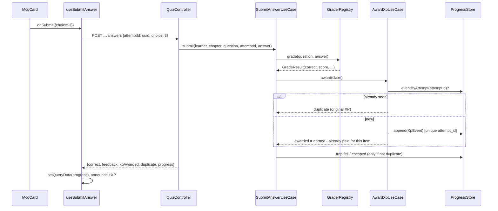

# 2. Request flows

## Start-up: online or offline?

The choice is made once, in the composition root (`app/services.tsx`). No component ever checks the mode to decide
how to fetch; it just calls the interface.

## Opening a chapter

1. `ChapterPage` calls `useChapter(id)` → `ContentService.getChapter` → `GET /api/v1/chapters/{id}`.
2. `ContentController` → `GetChapterUseCase` → `ContentSource.chapter(id)` (an in-memory snapshot; no disk read
   per request).
3. `QuestionView.of` maps each sealed `Question` to a flat JSON object with a `type` field.
4. Theory is not in that response: `TheoryView` lazy-loads the chapter's compiled `theory.mdx` chunk from the bundle.

## Answering a question

The `attemptId` is created once per click. TanStack Query retries the mutation (up to 2 times) with the **same**
variables, so a flaky network can retry safely: the server answers `duplicate: true` and XP is never doubled.

## Pressing Run

1. `RunnableCode` → `CodeRunner.run(source)` → `POST /api/v1/runs`.
2. `RunController` (api) validates size → `RunSnippetUseCase` → `CodeExecutor` = `RunnerHttpClient`.
3. `RunnerHttpClient` goes through the circuit breaker, adds `X-Request-Id`, and calls
   `POST runner:8091/internal/v1/runs` with a 1 s connect and 15 s read timeout.
4. Runner: `RunCodeUseCase` admits the run into the bounded pool (or 429), creates a temp folder, compiles in-process,
   runs a child JVM with limits, deletes the folder, returns `RunResult`.
5. Outcomes reaching the UI:
   - `200` with `status` OK / COMPILE_ERROR / RUNTIME_ERROR / TIMEOUT / OUTPUT_LIMIT → shown with a badge;
   - `429 runner-busy` → "busy", stored output shown;
   - `503 runner-unavailable` (down, timeout, or circuit open) → stored output shown with a "Stored output" badge.

## Interview angle

"How do you make a POST safe to retry?" Client-generated idempotency key, unique constraint as the real guard,
replay the original result on a duplicate. Same pattern as payment APIs.
