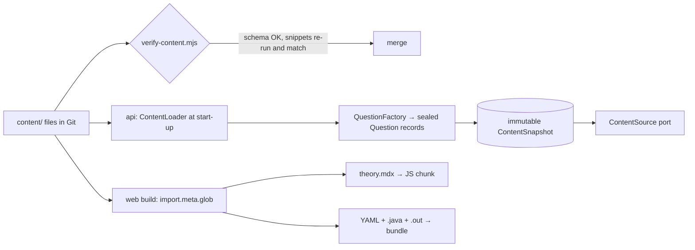

# 6. Content pipeline

## Two readers, one format

- **api**: `FileSystemContentSource` loads every `series.yaml` and the chapters it lists into one immutable
  snapshot. Bad content throws with the folder name, so the api refuses to start rather than serve a broken page.
  In `dev` (`stackcraft.content.reload=true`) it re-fingerprints the folder at most once a second; if anything
  changed it reloads and swaps the snapshot atomically. A broken edit is logged and the last good snapshot stays.
- **web**: Vite globs `content/**` at build time. YAML is parsed by `bundledContent.ts` with the same defaults as the
  Java loader; `.java` and `.out` files feed `RunnableCode`; `theory.mdx` is compiled to a lazy chunk.

## Why answers are in the payload

The content is in a public repo, and this is a study tool; the UI reveals answers only after a commit. If
competitive scoring ever matters, a `PublicQuestionView` that strips answers is one adapter change (ADR 0002).

## The gate: verify-content

`node scripts/verify-content.mjs`

1. schema-checks every file (required fields, enums, option indexes, unique ids, exactly 3 hints per problem, every
   listed folder and code file exists, every `<RunnableCode file>` is listed in `codeFiles`);
2. runs every `code/*.java` with the JDK and compares stdout to its `.out` (line endings normalised);
3. runs every `predict` question's code and compares to `expected` with the grader's whitespace rule.

`--no-run` skips the JDK; `--write-out` regenerates `.out` files (review the diff).

## Interview angle

"How would you let non-engineers edit content safely?" Content as data with a schema, a CI gate that executes
examples, fail-fast loading, and hot reload that never replaces good content with bad.
