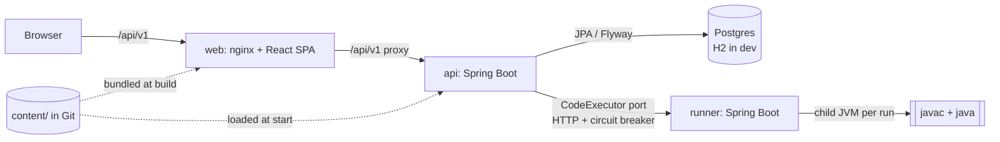

# Architecture

Stackcraft is small, but it is built the way a production system would be, because the LLD, HLD and Cloud series
use it as their case study.

## Reading order

1. [System overview](01-system-overview.md)
2. [Request flows](02-request-flows.md)
3. [The api service](03-api-service.md)
4. [The runner service](04-runner-service.md)
5. [The web app](05-web-app.md)
6. [Content pipeline](06-content-pipeline.md)
7. [Data and progress](07-data-and-progress.md)
8. [Resilience and security](08-resilience-and-security.md)
9. [Deployment](09-deployment.md)

## Principles, and where to see them

| Principle | Where |
|---|---|
| Single responsibility | one use case per class; controllers only map HTTP; `Grader` grades and nothing else; the runner only runs code |
| Open/closed | new question type = new record + new `Grader` bean + new renderer; `GraderRegistry` and `QuestionList` never change |
| Liskov | `GraderContractTest` runs one contract against every grader; every renderer takes `QuestionRendererProps` |
| Interface segregation | `ProgressReader` vs `ProgressWriter`; `ContentSource` is read-only; small React hooks (`useXp`, `useStreak`) |
| Dependency inversion | use cases depend on ports (`ContentSource`, `ProgressStore`, `CodeExecutor`, `Compiler`, `Sandbox`); the web depends on `ContentService`, `ProgressService`, `CodeRunner` |
| API-first | `docs/api/openapi.yaml` → generated TS types; `OpenApiContractTest` keeps the controllers honest |
| 12-factor config | every setting is an environment variable; profiles `dev` (H2) and `prod` (Postgres) |
| Idempotency | client-generated `attemptId` with a unique constraint |
| Backpressure | the runner's bounded queue returns 429 |
| Fail fast, degrade gracefully | bad content stops start-up; a dead runner opens a circuit and the UI shows stored output |
| Enforced boundaries | ArchUnit tests in both services |
